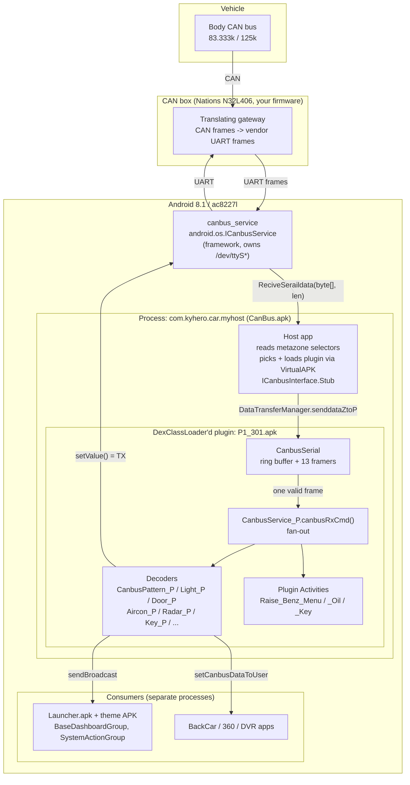
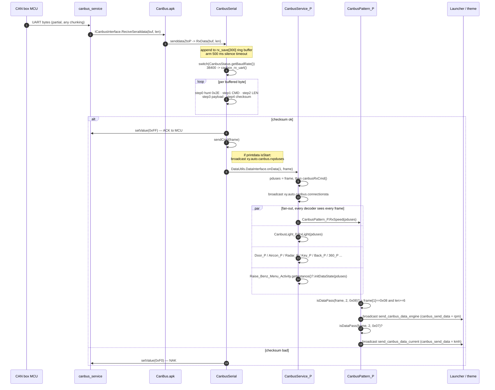
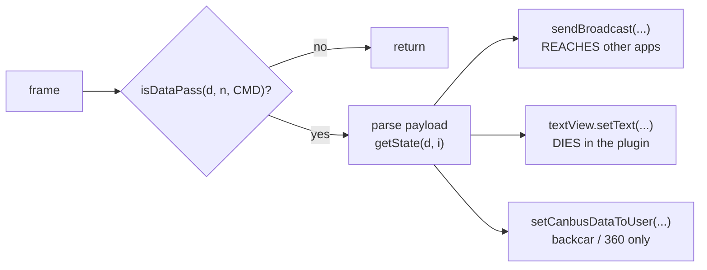
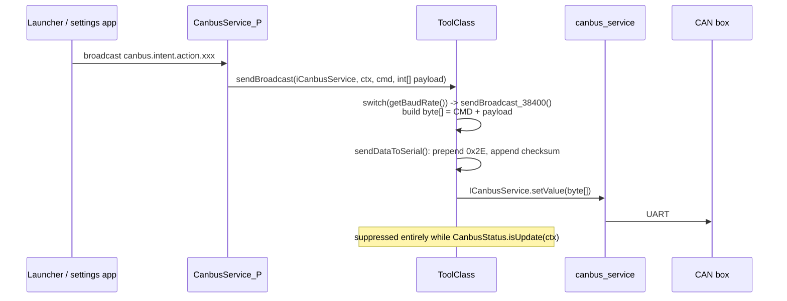
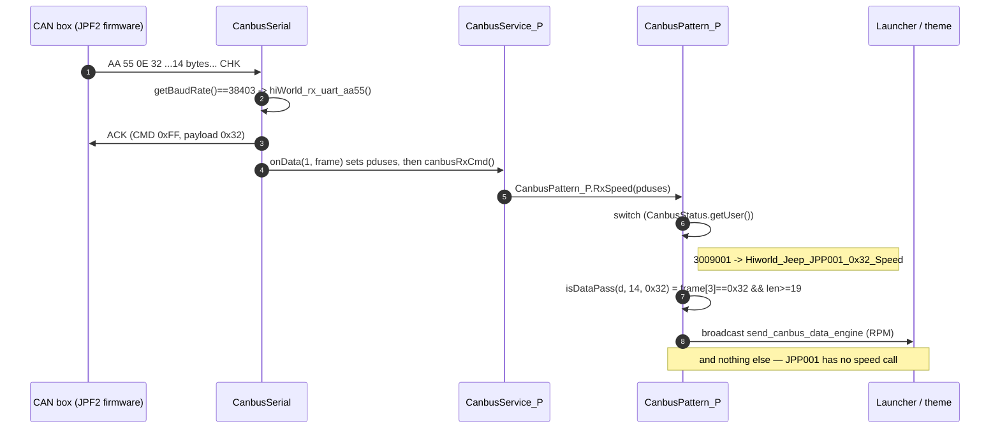

# How CAN data gets from the box to the launcher

Everything below is read out of the two APKs actually on this unit:

- host   `my-radio-files/CanBus/host/1_023/CanBus.apk`   (`com.kyhero.car.myhost`)
- plugin `my-radio-files/CanBus/plugin/1/34/P1_301.apk`  (`com.kyhero.car.myplugin`, Raise / Benz)
- plugin `my-radio-files/CanBus/plugin/3/9/P1_501.apk`   (same package, Hiworld / Jeep — section 9)

Verified 2026-10-17 by dex disassembly, not inferred.

---

## 1. One-paragraph answer

The MCU sends framed bytes over UART. A **framework** service (`canbus_service`,
`android.os.ICanbusService`, baked into this ROM) owns the serial port and pushes raw
chunks up. The **host app** `CanBus.apk` owns no protocol at all — its job is to pick and
`DexClassLoader` the right **plugin APK** for this car, and relay bytes to it. Inside the
plugin, `CanbusSerial.RxData()` is the **byte-stream reassembler**: it appends chunks to a
ring buffer and runs a state machine until one complete, checksum-valid frame exists. That
frame is handed to `CanbusService_P.canbusRxCmd()`, which **fans it out to every decoder in
the plugin** — doors, lights, aircon, radar, keys, pattern/speed — plus any plugin Activity
currently on screen. Each decoder tests the frame's command byte, and if it matches,
converts the payload into a **plain Android broadcast**. Those broadcasts are the only
public API: the Launcher, the theme, and any other app just `registerReceiver`.

So: **UART → framework service → host → plugin framer → fan-out → per-CMD decoder → broadcast → Launcher.**

---

## 2. Component diagram



Two things people get wrong here:

- **`CanBus.apk` is not the protocol.** It is a loader. All decoding lives in the plugin.
- **The plugin is not a separate process.** VirtualAPK (`com.didi.virtualapk.PluginManager`)
  loads `P1_301.apk` *into the host process*, so its Services and Activities run without
  ever being installed and no signature is checked. This is why patching a plugin APK works.

---

## 3. Sequence diagram — receive path



The fan-out is **unconditional and stateless**: every decoder sees every frame and decides
for itself. There is no routing table. A frame nobody claims is simply dropped.

---

## 4. `CanbusSerial.RxData` — what it actually does

`RxData(byte[] buf, int len)` is **only** the reassembler. It never decodes meaning.

```java
void RxData(byte[] buf, int len) {
    int fmt = CanbusStatus.getBaudRate();      // wire-format selector, see section 5
    handler.removeCallbacks(delayOvertime);
    handler.postDelayed(delayOvertime, 500);   // 500 ms silence -> "box disconnected"
    for (int i = 0; i < len; i++) {
        rx_save[rx_put++] = buf[i];
        if (rx_put >= 300) rx_put = 0;         // 300-byte ring buffer
    }
    switch (fmt) {                             // 13 different wire formats
        case 9601:  anyuan_rx_uart();        break;
        case 9602:  foton_rx_uart();         break;
        case 19200: elysee_rx_uart();        break;
        case 19201: hyudnai_rx_uart();       break;
        case 19202: qiruiA3_rx_uart();       break;
        case 19203: tpms_rx_uart();          break;
        case 19205: hiWorld_rx_uart_aa55();  break;
        case 38401: hiWorld_rx_uart();       break;
        case 38402: X80_rx_uart();           break;
        case 38403: hiWorld_rx_uart_aa55();  break;
        case 38405: xp_rx_uart_fd();         break;
        case 38406: xp_rx_uart_aa55();       break;
        case 38407: hiWorld_rx_uart_key();   break;
        default:    canbox_rx_uart();        break;  // <-- Raise Benz (38400) lands here
    }
}
```

Each `*_rx_uart()` is a byte-at-a-time state machine over the ring buffer. They differ only
in framing (sync bytes, where the length is, checksum algorithm). On a good frame they all
do the same three things: **ACK the MCU**, optionally **mirror the frame as a broadcast**,
and call `sendCmd(frame)`.

### The Raise `canbox` frame — what your box must emit

```
  2E   CMD   LEN   payload[0..LEN-1]   CHK
  |    |     |                          |
  |    |     |                          +-- (~(CMD + LEN + sum(payload))) & 0xFF
  |    |     +-- payload length
  |    +-- command byte
  +-- SOF, literal '.' (0x2E)
```

- `rx_pos > 120` aborts the frame.
- Standalone `0xFF` / `0xF0` bytes seen while hunting for SOF are the box's own ACK/NAK and
  are mirrored to `rxpduses` as 1-byte frames.
- On success the head unit replies `0xFF` on the wire; on a parse exception, `0xF0`.

### `sendCmd` is the handoff

```java
void sendCmd(byte[] frame) {
    DataUtils.getInstance().getDataInterface().onData(1, frame);          // -> plugin
    if (isStart) ctx.sendBroadcast(intent.putExtra("rxpduses", frame));   // debug mirror
}
```

and the plugin's implementation of that interface is two lines:

```java
public void onData(int what, byte[] frame) {
    CanbusService_P.pduses = frame;     // static handoff slot
    CanbusService_P.this.canbusRxCmd(); // fan-out
}
```

---

## 5. Selectors: `canId` / `carBrandId` / `carId` / `Canset_User` / `baudRate`

There are **two independent selectors**, and conflating them is where the confusion starts.

### 5a. Which plugin to load — from the metazone partition

`ConfigUtil.readMetazonedata()` reads three ints out of the **metazone reserved area**
(`AtcMetazone.readreserved` on this ac8227l board) into `carData[3]`, and mirrors them into
`Settings.System`:

| `carData` | getter | Settings.System key | your value |
|---|---|---|---|
| `[0]` | `getCanId()` | `canbus.can.id` | `1` = Raise / 睿志诚 |
| `[1]` | `getCarBrandId()` | `canbus.car.brand.id` | `34` = Mercedes-Benz |
| `[2]` | `getCarId()` | `canbus.car.id` | `27` = car/protocol variant |

Because it lives in metazone, the car selection **survives a factory reset and a `/data` wipe**.

The APK path is just string concatenation:

```java
// PluginUtils.getRelativePluginName(canId, brandId, pluginFileName)
"plugin" + "/" + canId + "/" + brandId + "/" + pluginFileName
//  -> /storage/emulated/0/CanBus/plugin/1/34/P1_301.apk
```

`getCarPlugin()` resolves the filename (`P1_301.apk`) from the connect tables, with a
`debugVerStr` override in `Settings.System`.

### 5b. `protocol_id` (= `Canset_User`) — which car *inside* the plugin

One plugin APK serves a whole brand (all Benz models). The specific car is a single decimal
integer built by concatenating the three selectors with zero padding:

```java
int getUser(ctx) {
    return Integer.parseInt( getCanId(ctx)                                // 1
                           + String.format("%03d", getCarBrandId(ctx))    // "034"
                           + String.format("%03d", getCarId(ctx)) );      // "027"
}   // -> 1034027
```

`PluginUtils.loadPlugin()` then does:

```java
int user = ConfigUtil.getUser(ctx);
Settings.System.putInt(cr, "Canset_User", user);   // readable from adb
CanbusStatus.setUser(user);                        // in-process copy
```

and the plugin re-reads it in `CanbusService_P.onCreate()`. Inside decoders it appears as
`CanbusStatus.getUser()` and is normally the `switch` subject that picks a per-model layout —
exactly like the Jeep plugin's `3009001…3009011` ladder.

```bash
adb shell settings get system Canset_User           # 1034027
adb shell settings get system canbus.can.id         # 1
adb shell settings get system canbus.car.brand.id   # 34
adb shell settings get system canbus.car.id         # 27
```

> **Quirk worth knowing for Benz:** `CanbusPattern_P.RxSpeed` *calls* `getUser()` and then
> **discards the result** — `raise_benz_Speed()` runs unconditionally. So on this plugin the
> `protocol_id` does not gate RPM/speed at all; any Benz `carId` decodes 0x07 / 0x08.

### 5c. `baudRate` — which *wire format*, not which car

`CanbusStatus.getBaudRate()` looks like a UART speed but is really a **format id**: real baud
in the leading digits plus a variant index (`19205`, `38403`… are not valid baud rates).
It is **not a user setting** — each plugin hardcodes its own:

```java
// CanbusConfig_P in P1_301.apk — the whole class
static int getBaudRate()    { CanbusStatus.getUser(); return 38400; }  // result ignored
static int getRequestData() { CanbusStatus.getUser(); return 144;   }  // 0x90
static void loadConfig() {
    CanbusStatus.setBaudRate(getBaudRate());
    ToolClass.setRequestData(getRequestData());
    ToolClass.setDataConfig();          // derives the byte offsets below
}
```

It drives **two** switches that must agree:

1. `CanbusSerial.RxData` → which framer runs (section 4).
2. `ToolClass.setDataConfig()` → where CMD and payload sit in the assembled frame:

| `getBaudRate()` | `dataTypeIndex` (CMD at) | `dataIndexOffset` (payload at) | `dataExtraLength` |
|---|---|---|---|
| 19200, 19201, 19202, 38402, 38405 | 2 | 3 | 1 |
| 19205, 38401, 38403, 38407 | 3 | 4 | 5 |
| 38406 | 3 | 4 | 4 |
| **anything else, incl. 38400 (Benz)** | **1** | **3** | **4** |

Exactly consistent with the `2E CMD LEN … CHK` frame: CMD at index 1, payload at index 3,
4 bytes of overhead.

The three accessors every decoder uses:

```java
boolean isDataPass(byte[] d, int n, int cmd) {        // "is this my frame?"
    return d.length >= dataExtraLength + n
        && (d[dataTypeIndex] & 0xFF) == cmd;
}
int getState(byte[] d, int i)                 { return d[dataIndexOffset + i] & 0xFF; }
int getState(byte[] d, int i, int lo, int hi) { /* bit-range of that byte */ }
```

---

## 6. What a "0x41 decoder" is

Nothing special — just a decoder branch keyed on command byte `0x41`. In this plugin `0x41`
is the Benz rich-telemetry page, and it is read in **six** places:

| Class | Method | Sink |
|---|---|---|
| `CanbusAircon_P` | `raise_Benz_Aircon` | broadcast *(gated off, see below)* |
| `Raise_Benz_Menu_Activity` | `initDataState` | its own TextViews |
| `Raise_Benz_Oil` | `initDataState` | its own TextViews |
| `Raise_Benz_Key_Activity` | `initDataState` | its own TextViews |
| `Raise_Benz_Set_Activity` | `initDataState` | its own TextViews |
| `CarSetActivity` | `initDataState` | its own TextViews |

The Activities are pushed frames from the same fan-out, through a singleton:

```java
// CanbusService_P.canbusRxCmd()
if (Raise_Benz_Menu_Activity.getInstance() != null)
    Raise_Benz_Menu_Activity.getInstance().initDataState(pduses);
```

`getInstance()` is non-null **only while that screen is open**. So the ~52 Benz gauges
(torque, power, temperatures, oil) are decoded, written into a TextView, and thrown away.
**They are never broadcast** — that is the whole reason the launcher cannot show them. It is
not a missing permission and not a missing signal from your box.

The shape every decoder follows:



Three sinks exist; only the first one is an API.

---

## 7. Transmit path (launcher -> car)



`ToolClass.sendBroadcast` is badly named — it sends to the **serial port**, not to Android.

---

## 8. Everything the Benz plugin actually exposes to other apps

| Signal | CMD | Decode (default layout) | Broadcast | Extra |
|---|---|---|---|---|
| RPM | `0x08` | `d[3]*256 + d[4]` | `send_canbus_data_engine` | `canbus_send_data` (int) |
| Speed km/h | `0x07` | `d[3]*256 + d[4]` | `send_canbus_data_current` | `canbus_send_data` (int) |
| Instant. speed | `0x7D`, `d[3]==3` | `(d[5]*256 + d[4]) / 100` | `xy.auto.canbus.rx_Instantaneous_speed` | same name (int) |
| Average speed | `0x7D`, `d[3]==3` | `(d[7]*256 + d[6]) / 100` | `xy.auto.canbus.rx_Average_speed` | same name (int) |
| SWC keys | `0x20` | — | `canbus.intent.action.key` | `canbus_key` (byte[]) |
| Box alive | any frame | 1 Hz, first 20 only | `xy.auto.canbus.connectionsta` | `connectionsta` (bool) |
| Raw mirror | all | — | `xy.auto.canbus.rxpduses` | `rxpduses` (byte[]) |

0x7D is additionally rate-limited to one send per 1000 ms.

**Blocked on this hardware:**

- Doors (`com.xygala.canbus.doordata`) — `CanbusDoor_P.showDoor()` requires
  `ToolClass.getMachineType() == 3` (SM6115/qcom). `ac8227l` returns **2**. Never fires.
- HVAC (`canbus.aircon.conrol.rx.action`) — gated on static
  `AirConditionerView.isSendDataLauncher`; its setter `setSendDataLauncher` has **no callers**.
- Everything on the `0x41` page — activity-only, see section 6.

**The escape hatch** (no plugin patch needed):

```bash
adb shell am broadcast -a com.xygala.canbus.printdata --ez isStart true
```

flips `CanbusSerial.isStart`, after which **every** valid frame is rebroadcast verbatim as
`xy.auto.canbus.rxpduses` (byte[] `rxpduses`) and every TX frame as
`xy.auto.canbus.txpduses`. A theme or app can then decode 0x41, doors, anything — at the
cost of one broadcast per frame. The receiver is registered in `CanbusSerial.registerReceiver()`.

Sanity-test consumers without driving:

```bash
adb shell am broadcast -a send_canbus_data_engine  --ei canbus_send_data 2500
adb shell am broadcast -a send_canbus_data_current --ei canbus_send_data 88
```

---

## 9. Worked example 2 — Hiworld JPF2 on the Jeep WK

Same pipeline, different numbers everywhere. Source: `my-radio-files/CanBus/plugin/3/9/P1_501.apk`
(the one the unit actually loads; `P1_301.apk` sits next to it as the older build and is
identical in everything discussed here).

### 9.1 Selectors

| | value | where from |
|---|---|---|
| `canId` | `3` = Hiworld | metazone `carData[0]` → `canbus.can.id` |
| `carBrandId` | `9` = Jeep/FCA | metazone `carData[1]` → `canbus.car.brand.id` |
| `carId` | `1` = JPF2 | metazone `carData[2]` → `canbus.car.id` |
| plugin path | `/sdcard/CanBus/plugin/3/9/P1_501.apk` | `"plugin/" + 3 + "/" + 9 + "/" + name` |
| `Canset_User` (`protocol_id`) | **`3009001`** | `parseInt("3" + "009" + "001")` |

### 9.2 Here `baudRate` *does* depend on `protocol_id`

This is the part that differs from Benz. The Jeep plugin's `CanbusConfig_P` actually uses
the value it reads:

```java
static int getBaudRate() {
    switch (CanbusStatus.getUser()) {
        case 3009001:            // JPF2  <-- the WK
        case 3009002: return 38403;
        default:      return 38401;
    }
}
```

So one plugin file serves two different wire formats, and `protocol_id` is what picks:

| `Canset_User` | `baudRate` | framer | RX sync | TX sync |
|---|---|---|---|---|
| **3009001, 3009002 (JPF2)** | **38403** | `hiWorld_rx_uart_aa55()` | **`AA 55`** | **`AA 55`** |
| every other Jeep id | 38401 | `hiWorld_rx_uart()` | `5A A5` | `5A A5` |

**This settles the AA55-vs-5AA5 question for good:** it is not a vendor-wide constant, it is
selected by `protocol_id` through `baudRate`. Verified both directions — RX hunts
`0xAA`/`0x55` in `hiWorld_rx_uart_aa55` and `0x5A`/`0xA5` in `hiWorld_rx_uart`; TX writes the
same pair in `ToolClass.sendDataToSerial`.

Both land in **layout group B** of `setDataConfig()`:

```
dataTypeIndex = 3    dataIndexOffset = 4    dataExtraLength = 5
```

### 9.3 The JPF2 frame

```
  AA   55   LEN   CMD   payload[0..LEN-1]   CHK
  |    |    |     |                          |
  |    |    |     |                          +-- (LEN + CMD + sum(payload) - 1) & 0xFF
  |    |    |     +-- index 3 = dataTypeIndex
  |    |    +-- payload length (NOT counting CMD)
  +----+-- sync
```

- total length = `payload_len + 5` = `dataExtraLength + payload_len` ✓
- `payload[i]` = `frame[4 + i]` ✓
- `rx_pos > 50` aborts the frame (the Raise framer allows 120)
- on checksum pass: ACK by transmitting `CMD 0xFF` with the received CMD as its one payload
  byte; on checksum fail: `CMD 0xFE` the same way
- TX is exactly symmetric: `sendBroadcast_38401_38403_38407` builds
  `[payload.length, CMD, payload...]`, then `sendDataToSerial` wraps it as
  `AA 55 … CHK` with the identical `-1` checksum

### 9.4 Same fan-out, different decoder



```java
// CanbusPattern_P, P1_501.apk
void Hiworld_Jeep_JPP001_0x32_Speed(byte[] d) {          // 3009001, 3009002
    if (ToolClass.isDataPass(d, 14, 0x32))               // len >= 19, frame[3] == 0x32
        SendDataEngine(getState(d,2)*256 + getState(d,3), mContext);   // RPM only
}
void Hiworld_Jeep_JPP004_0x32_Speed(byte[] d) {          // 3009003..3009008, 3009014, 3009019..25
    if (ToolClass.isDataPass(d, 14, 0x32)) {
        SendDataEngine(getState(d,2)*256 + getState(d,3), mContext);   // RPM
        SendDataSpeed (getState(d,4)*256 + getState(d,5), mContext);   // km/h
    }
}
```

`SendDataEngine` / `SendDataSpeed` are byte-for-byte the same as the Benz plugin's —
`send_canbus_data_engine` / `send_canbus_data_current`, int extra `canbus_send_data`. A theme
written for one works unchanged on the other.

### 9.5 The trap: `3009001` broadcasts RPM but **not** speed

`RxSpeed`'s `packed-switch` over `3009001…3009025` resolves like this:

| `Canset_User` | decoder | RPM | speed |
|---|---|---|---|
| 3009001, 3009002 | `JPP001` | yes | **no** |
| 3009003 – 3009008 | `JPP004` | yes | yes |
| 3009009 – 3009013 | *(falls through to `return`)* | no | no |
| 3009014 | `JPP004` | yes | yes |
| 3009015 – 3009018 | *(falls through to `return`)* | no | no |
| 3009019 – 3009025 | `JPP004` | yes | yes |

So on the WK as configured, `send_canbus_data_current` **never fires**, no matter what your
box puts in `payload[4..5]` of `0x32`. The bytes arrive and are discarded by the host.

Three ways out, cheapest first:

1. **Change `carId` to a JPP004 id** (e.g. `3009003`) if the rest of that profile is
   compatible — then the existing `0x32` frame yields both RPM and speed with no code change.
2. **Patch `RxSpeed`** in `P1_501.apk` to call `JPP004` for `3009001`. VirtualAPK does not
   verify signatures (section 2), so a re-zipped APK loads fine.
3. **Decode `rxpduses` in the theme** — `printdata isStart true`, then read
   `frame[8]`/`frame[9]` yourself.

### 9.6 `0x32` payload map (for your box firmware)

Payload index, i.e. `getState(d,i)` = `frame[4+i]`:

| payload idx | frame idx | meaning | scale |
|---|---|---|---|
| `[1]` | `d[5]` | gear | raw |
| `[2..3]` | `d[6..7]` | **RPM** | BE16 |
| `[4..5]` | `d[8..9]` | **speed km/h** (JPP004 only) | BE16 |
| `[6]` | `d[10]` | battery volts | ×0.1 |
| `[8]`, `[9]`, `[12]`, `[13]` | — | temperatures | −40 |
| `[10..11]` | — | oil pressure | ×0.1 |

Minimum frame your firmware must emit for RPM to appear on the dashboard:

```
AA 55 0E 32 <14 payload bytes> CHK      CHK = (0x0E + 0x32 + sum(payload) - 1) & 0xFF
```

(`isDataPass(d, 14, 0x32)` needs `d.length >= 5 + 14 = 19`, so `LEN` must be at least `0x0E`.)

### 9.7 Benz vs JPF2 side by side

| | Raise Benz (1/34) | Hiworld JPF2 (3/9) |
|---|---|---|
| `Canset_User` | 1034027 | 3009001 |
| plugin | `plugin/1/34/P1_301.apk` | `plugin/3/9/P1_501.apk` |
| `getBaudRate()` | constant `38400` | `switch(getUser())` → 38403 / 38401 |
| framer | `canbox_rx_uart` | `hiWorld_rx_uart_aa55` |
| sync | `2E` | `AA 55` |
| CMD at | `frame[1]` | `frame[3]` |
| payload at | `frame[3]` | `frame[4]` |
| overhead | 4 | 5 |
| checksum | `~(CMD+LEN+Σ) & 0xFF` | `(LEN+CMD+Σ−1) & 0xFF` |
| max frame | 120 | 50 |
| RPM | CMD `0x08`, payload `[0..1]` | CMD `0x32`, payload `[2..3]` |
| speed | CMD `0x07`, payload `[0..1]` | CMD `0x32`, payload `[4..5]` — **not on 3009001** |
| `protocol_id` gates decode? | no (result discarded) | yes, heavily |
| doors broadcast | no (`getMachineType()!=3`) | no (same gate) |

The door gate is in the shared `CanbusDoor_P`, so it blocks both plugins on this ac8227l
board identically. Nothing car-specific about it.

---

## 10. Cheat sheet

| Thing | Lives in | Role |
|---|---|---|
| `canbus_service` | ROM framework | owns the UART; `setValue()` = TX, `ICanbusInterface` = RX |
| `CanBus.apk` | `/system`, host process | selector lookup + VirtualAPK loader + byte relay. **No protocol.** |
| `P1_301.apk` | `/sdcard/CanBus/plugin/1/34/` | the entire protocol: framer, decoders, Activities, settings UI |
| `CanbusSerial.RxData` | plugin | ring buffer + framing only. Produces whole frames. |
| `CanbusService_P.canbusRxCmd` | plugin | stateless fan-out of one frame to all decoders + open Activity |
| `CanbusXxx_P.RxYyy` | plugin | `isDataPass(CMD)` -> parse -> **broadcast** |
| `canId` / `brandId` / `carId` | metazone partition | which plugin file to load |
| `Canset_User` (`protocol_id`) | derived, `Settings.System` | which car *inside* that plugin |
| `baudRate` | each plugin's `CanbusConfig_P` — constant (Benz) or `switch(getUser())` (Jeep) | which wire format + which byte offsets |
| broadcasts | Android | the only public API |
